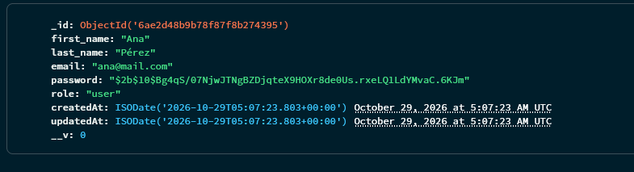
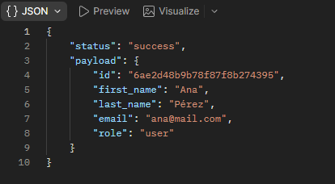
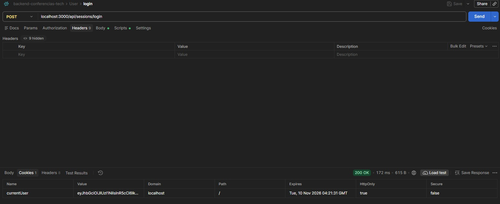
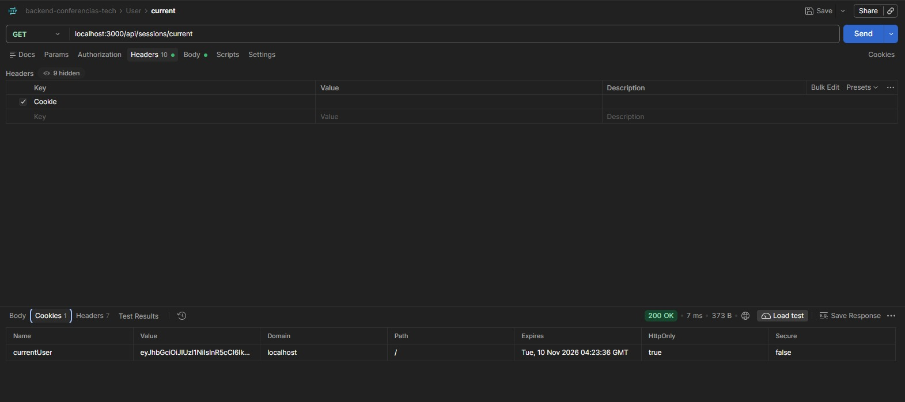
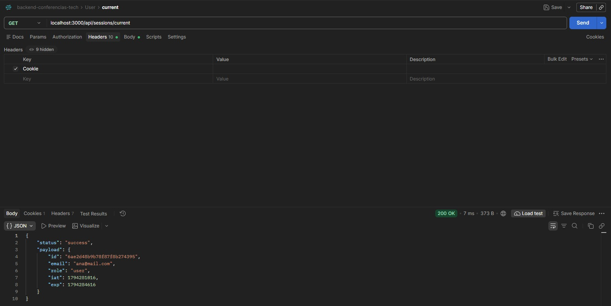
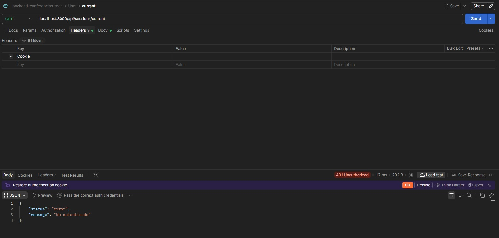

# Charla

Plataforma para la gestión de conferencias y charlas de tecnología. Permite crear eventos, organizar sus sesiones (charlas y talleres) y gestionar usuarios con distintos roles (`admin`, `organizer`, `user`).

## Tecnologías

- **Node.js** + **Express 5**
- **MongoDB** con **Mongoose**
- **bcrypt** para el hash de contraseñas
- **jsonwebtoken** para firmar y verificar JWT
- **cookie-parser** para leer la cookie de sesión
- **dotenv** para variables de entorno
- Módulos **ESM** (`import` / `export`)
- **pnpm** como gestor de paquetes

## Instalación

1. Cloná el repositorio:

   ```bash
   git clone https://github.com/DiegoLeonardoSoto/proyecto-backend-eventos
   cd proyecto-backend-eventos
   ```

2. Instalá las dependencias:

   ```bash
   pnpm install
   ```

3. Copiá el archivo de variables de entorno y completá los valores:

   ```bash
   cp .env.example .env
   ```

## Variables de entorno

| Variable     | Descripción                    | Ejemplo                          |
| ------------ | ------------------------------ | -------------------------------- |
| `PORT`       | Puerto donde corre el servidor | `3000`                           |
| `NODE_ENV`   | Entorno de ejecución           | `DEV`                            |
| `MONGO_URL`  | URL de conexión a MongoDB      | `mongodb://localhost:27017/charla` |
| `JWT_SECRET`     | Secreto para firmar tokens JWT | `un-secreto`                     |
| `JWT_EXPIRES_IN` | Tiempo de expiración del JWT   | `1h`                             |

## Cómo ejecutar

Modo desarrollo (con recarga automática):

```bash
pnpm dev
```

Modo producción:

```bash
pnpm start
```

El servidor queda escuchando en `http://localhost:3000`.

## Estructura de carpetas

```text
src/
├── app.js                        # Configura Express (no levanta el servidor)
├── server.js                     # Inicia el servidor
├── config/                       # Configuración de la app y la BD
│   ├── db.js                     # Conexión a MongoDB
│   └── env.config.js             # Variables de entorno
├── controllers/                  # Manejo de solicitudes HTTP
│   ├── events.controller.js
│   ├── health.controller.js
│   └── sessions.controller.js
├── dao/                          # Acceso directo a datos (mongoose)
│   └── users.dao.js
├── dependencies/                 # Composición de dependencias
│   └── user.dependency.js
├── middlewares/                  # Middlewares personalizados
│   └── auth.middleware.js        # Verificación de JWT (ruta protegida)
├── models/                       # Modelos de datos
│   ├── event.model.js
│   └── user.model.js
├── repositories/                 # Acceso a datos con intención de dominio
│   └── users.repository.js
├── routes/                       # Definición de rutas
│   ├── events.router.js
│   ├── health.router.js
│   └── sessions.router.js
├── services/                     # Lógica de negocio
│   └── sessions.service.js
└── utils/                        # Funciones auxiliares
    ├── AppError.js               # Error con código de status HTTP
    ├── hash.js                   # Hash y comparación de contraseñas (bcrypt)
    └── jwt.js                    # Firmar y verificar tokens JWT
```

## Rutas disponibles

| Método | Ruta                     | Descripción                          |
| ------ | ------------------------ | ------------------------------------ |
| `GET`  | `/api/health`            | Verifica que el servidor esté activo        |
| `GET`  | `/api/events`            | Lista de eventos                            |
| `POST` | `/api/sessions/register` | Registro de un nuevo usuario                |
| `POST` | `/api/sessions/login`    | Inicio de sesión (setea cookie `currentUser`) |
| `GET`  | `/api/sessions/current`  | Usuario autenticado (ruta protegida)        |
| `POST` | `/api/sessions/logout`   | Cierre de sesión (borra la cookie)          |

## Registro de usuarios

`POST /api/sessions/register`

### Campos esperados

| Campo        | Tipo   | Requerido | Descripción                                 |
| ------------ | ------ | --------- | ------------------------------------------- |
| `first_name` | string | Sí        | Nombre del usuario                          |
| `last_name`  | string | Sí        | Apellido del usuario                        |
| `email`      | string | Sí        | Email (se normaliza: trim + lowercase)      |
| `password`   | string | Sí        | Contraseña (mínimo 8 caracteres, se hashea) |

> El campo `role` no se recibe desde el body: se asigna automáticamente con el valor por defecto `user`.

### Request de ejemplo

```json
{
  "first_name": "Ana",
  "last_name": "Pérez",
  "email": "Ana@Mail.com ",
  "password": "Secreta123"
}
```

El email va en mayúsculas y con un espacio al final a propósito: el servidor lo normaliza a `ana@mail.com`.

### Respuestas

**`201 Created`** — registro exitoso (email normalizado, sin `password`):

```json
{
  "status": "success",
  "payload": {
    "id": "665f2a...",
    "first_name": "Ana",
    "last_name": "Pérez",
    "email": "ana@mail.com",
    "role": "user"
  }
}
```

**`400 Bad Request`** — campos faltantes, email inválido o contraseña inválida:

```json
{ "status": "error", "message": "Faltan campos obligatorios" }
```

**`409 Conflict`** — email ya registrado:

```json
{ "status": "error", "message": "El email ya está registrado" }
```

> La contraseña se guarda hasheada con `bcrypt` y **nunca** se devuelve en la respuesta.

## Inicio de sesión

`POST /api/sessions/login`

### Request de ejemplo

```json
{
  "email": "ana@mail.com",
  "password": "Secreta123"
}
```

### Respuestas

**`200 OK`** — credenciales correctas (además setea la cookie `currentUser` HttpOnly):

```json
{ "status": "success", "message": "Login correcto" }
```

**`401 Unauthorized`** — credenciales incorrectas (mensaje genérico: no distingue si falló el email o la contraseña):

```json
{ "status": "error", "message": "Credenciales inválidas" }
```

## Usuario actual (ruta protegida)

`GET /api/sessions/current`

Requiere la cookie `currentUser` con un JWT válido (seteada en el login).

### Respuestas

**`200 OK`** — con cookie válida:

```json
{
  "status": "success",
  "payload": {
    "id": "665f2a...",
    "email": "ana@mail.com",
    "role": "user"
  }
}
```

**`401 Unauthorized`** — sin cookie o con token inválido/expirado:

```json
{ "status": "error", "message": "No autenticado" }
```

## Cierre de sesión

`POST /api/sessions/logout`

Elimina la cookie `currentUser`.

### Respuesta

**`200 OK`** — sesión cerrada (borra la cookie):

```json
{ "status": "success", "message": "Sesión cerrada" }
```

## Evidencia

### Registro

Contraseña hasheada en MongoDB (no en texto plano):



Respuesta del endpoint sin el campo `password`:



### Autenticación

Login exitoso — respuesta `200` con la cookie `currentUser` HttpOnly:



`/current` enviando la cookie en el request:



`/current` con cookie — respuesta `200`:



`/current` sin cookie — respuesta `401`:


